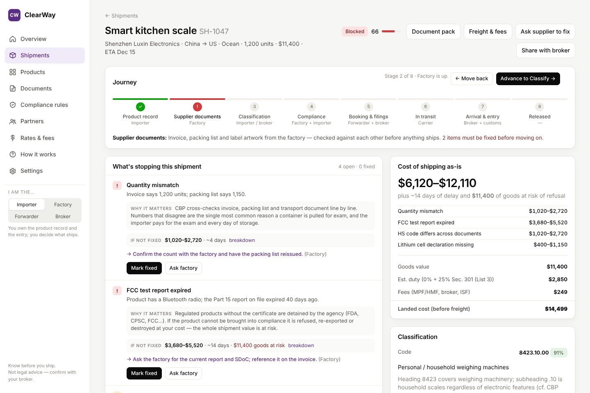

# ClearWay

**Know before you ship.** ClearWay is a shipment-readiness dashboard for small and mid-size importers and their suppliers. Upload the commercial invoice, packing list and bill of lading for a shipment and ClearWay:

1. **Extracts** the key fields from each document (with Claude, reading the real PDF/image/CSV),
2. **Cross-checks** them against each other — quantity, weight, description, consignee, HS code, Incoterm, value — and highlights every mismatch (the #1 cause of customs holds),
3. **Flags regulatory requirements** for the destination market from the product description (FCC, CPSC/CPC, FDA/MoCRA, lithium batteries, GPSR Responsible Person, CE/WEEE, UKCA, Lacey, origin marking, ISF…),
4. **Suggests a tariff classification** with a rationale and confidence,
5. Produces a **Readiness score** with a list of blockers and the fix for each, and plots every shipment on a risk map so the ones most likely to be held stand out.

It is built for the moment *before booking*, when problems are cheap to fix — not after the container is at the port.


## What's inside

| Page | What it does |
|---|---|
| **Overview** | A **route map** (MapLibre GL + OpenFreeMap vector tiles — free, no key, no limits; falls back to OpenStreetMap raster, then an SVG sketch) of every shipment on the move (origin → destination, progress dot, colour = status); what needs your attention first, with the cost of leaving it; where every shipment sits on its journey; next deadlines. |
| **Shipments** | All shipments, sorted by what needs you first — stage, readiness, open items, cost if not fixed, next deadline. |
| **Shipment detail** | The journey (8 stages, who owns each), a **tracking card** (route map, milestones booked → departed → arrived → released, carrier / vessel / container with a tracking link), every blocker with *why it matters* and *what it costs if not fixed*, three-way document check, classification, required certificates, landed-cost estimate. Mark items fixed, ask the supplier (English / 中文), share with the broker. |
| **Products** | One record per product: description, markets, classification, requirements on file, certificates with expiry. Every shipment inherits it. |
| **Documents** | Every document seen, and whether it agrees with the others on the same shipment. |
| **Knowledge base** | Coverage map per market, official datasets on the server, source registry (US/CA/EU/UK/CN), ingestion status. |
| **Compliance rules** | Each market's requirements in plain language, who provides them, official links, and what each costs when missing. Includes a "check a product" box. |
| **Partners** | Factories, forwarders, brokers — with a document-quality score and one-click document requests. |
| **Document pack** (per shipment) | Destination paperwork prefilled from the product record and your settings: commercial invoice, packing list, ISF 10+2 worksheet (US), CBSA B3/CARM data (Canada), EU/UK declaration data, certificate of origin, and a shipper's letter of instruction for the factory. Missing required fields are highlighted. Print or copy. |
| **Rates & fees** | Freight estimate for the lane (built-in ranges, or live quotes once a rate API key is configured) plus every destination fee (MPF/HMF, ISF, bond, broker, GST/VAT, THC). |
| **How it works** | The operating model: the problem, the 8-stage journey, who does what, and an honest statement of what the rules cover. |
| **Settings** | Company / IOR details, extraction status, and the editable cost model behind every estimate. |

### Origins

Shipments can originate anywhere — China is the default, with ports/airports for 30+ origin countries built in (`public/map.js`). Rules are destination-driven; China-specific measures (Section 301, UFLPA) only apply to China-origin goods. Freight estimates scale by origin lane.

### Compliance knowledge — three layers

1. **Sourced assessment (per product, per market).** `POST /api/assess` asks Claude — with live web search — for a structured assessment: classification with duty and additional measures, every requirement with its **legal basis, agency, who provides it, when it's needed, consequence if missing, confidence and source links**, mandatory label elements (incl. language rules), open questions, and rules known to be changing. Stored on the product with the generation date; the UI shows a **broker-review stamp** (reviewed by / when / notes). Needs `ANTHROPIC_API_KEY`.
2. **Official data joins (no key).** `GET /api/measures` returns the UK Trade Tariff's import *measures and document conditions* for a commodity code — the actual certificate codes customs demands at the border (shown as an approximation for EU, which shares the schema); `GET /api/rulings` searches CBP CROSS for classification precedents; `GET /api/tariff` queries USITC / UK schedules.
3. **Built-in catalog** (`rules.js`, 60+ rules across US/CA/EU/UK) as the floor when there is no assessment yet, with a coverage badge so nobody mistakes it for complete.

Everything is advisory and says so. The product is designed around the broker confirming, not replacing them.

### Knowledge base (More → Knowledge base)

Markets: **US, Canada, EU, UK, and China as a destination**. The page shows a coverage map (product attribute × market), the official datasets ingested on your server, and a source registry per market — what exists, in what format, how often it changes, and whether ClearWay auto-ingests it, queries it live, needs a manual export, or just links to it.

```bash
npm run ingest            # USITC HTS (US) + UK Trade Tariff nomenclature (UK, approximates EU)
npm run ingest -- us      # one market
```
Datasets land in `data/kb/` and power offline tariff search (`/api/tariff` falls back to them when the live site is unreachable). Manual exports with documented columns: CBP ACE PGA flag table (`us-pga-flags.csv` — the official HTS→agency map), EU TARIC measures (`eu-taric-measures.csv`), CBSA tariff (`ca-tariff.csv`), GACC tariff (`cn-tariff.csv`).

What "all the compliance data" realistically means: tariff schedules and border measures are machine-readable and ingested; agency flags per code exist as tables (US, EU/UK) and are ingested or queried; product-safety law is text — the catalog (109 rules) encodes the main obligations with official links, and sourced assessments + broker review cover the long tail per product.

### Bringing your own data

**Products → Import CSV** (`name, description, category, supplier, markets`) and **Shipments → Import CSV** (`product, origin, destination, mode, units, value, load_date, eta`).

### Markets, attributes and rule coverage

Markets: **US, Canada, EU, UK**. Rules fire on **product attributes** (has a radio, contains a battery, for children, touches food, cosmetic, textile, wood, chemical, medical, food, sold to consumers) that are derived from the description and can be corrected on the product page. Every requirement says *why it applies*, who provides it, links to the official agency page, and what it costs when missing. Each product shows a **rule coverage** badge per market — the catalog (50+ rules) is deep for electronics, children's products, food-contact goods and consumer labelling (including Canada's bilingual/Quebec French rules and EU local-language requirements) and a starting point elsewhere. It is a starting point, not legal advice: confirm with a broker.

### Roles

Pick *Importer / Factory / Forwarder / Broker* in the sidebar. The overview shows that role's tasks first; blockers carry an owner; the shipper's letter of instruction and request messages (English / 中文) are how the importer hands work to the factory.

### The journey

Every shipment moves through the same eight stages: **Product record → Supplier documents → Classification → Compliance → Booking & filings → In transit → Arrival & entry → Released.** A blocker pins the shipment to the stage where it must be fixed, so the overview board shows at a glance where things are stuck and who (factory, importer, forwarder, broker) is up.

### The cost model

Every blocker carries an estimate of what it costs if shipped as-is — exam fees, demurrage per day, broker handling, 10% marking duty for unmarked goods, $5,000 ISF liquidated damages, bonded storage during an agency detention, and the goods value at risk when a product can be refused. Defaults are typical 2025–26 US West Coast figures and are editable in Settings; the assumptions live in `public/rules.js` (`COSTS` and `impact()`).



## Accounts

Run the server and open the app: you'll be asked to **sign in or create an account**. Each company gets a workspace saved on the server (`data/`, git-ignored) — shipments, products, partners, settings. Invite your factory, forwarder and broker from **Settings → Team**; when they sign up with the invited email they land in your workspace with that role. New workspaces start empty with a three-step getting-started checklist; sample data is opt-in.

Passwords are hashed (scrypt), sessions are HttpOnly cookies. This is a prototype account system suitable for a pilot behind HTTPS, not a hardened identity provider — swap in Auth0/Clerk/Supabase before a public launch. "Continue without an account" keeps everything in the browser only.

## Quick start

Requires Node 18+. No dependencies to install.

```bash
git clone https://github.com/khaled-agi/clearway.git
cd clearway
cp .env.example .env        # add ANTHROPIC_API_KEY to enable real extraction
npm start                   # http://localhost:3000
```

Without an API key the app runs in **simulated mode**: the whole UI works, extraction results are generated from your product description so you can demo the flow. With `ANTHROPIC_API_KEY` set, uploads are sent to your own server, which asks Claude to read the documents and return structured fields plus a classification.

Try it with the files in `samples/` (they contain deliberate mismatches: 1,200 vs 1,150 units, 594 vs 580 kg, two different HS codes, a trailing dot on the consignee).

## How it works

```
browser (public/)                      server (server/server.js)              Anthropic API
───────────────────                    ─────────────────────────              ─────────────
New shipment wizard
  ├─ describe goods, destination, mode
  ├─ drop invoice / packing list / BL ──▶ POST /api/analyze ──────────────────▶ Claude reads the
  │                                        (base64 docs + context)               documents, returns
  │◀──────────────────────────────────── { ex:{inv,pl,bl}, classification } ◀── JSON fields
  ├─ three-way comparison (rules.js)   ── mismatches, missing fields
  ├─ regulatory checklist (rules.js)   ── derived from description + market
  └─ readiness score ──▶ dashboard table + risk map + shipment drawer
```

- `public/index.html`, `styles.css`, `app.js` — all pages, the new-shipment wizard, and the shipment detail. Vanilla JS, hash-routed, no build step; data persists in the browser (localStorage).
- `public/rules.js` — the rules engine: requirements catalog per market, classification keywords, journey stages, cost model. Shared by browser and server.
- `server/server.js` — static file server + `/api/analyze`. Zero dependencies.
- `samples/` — example documents with known discrepancies.

### API

`POST /api/analyze`

```json
{ "desc": "Bluetooth kitchen scale, 1200 units", "dest": "US", "mode": "Ocean",
  "docs": { "inv": [{ "name": "ci.pdf", "type": "application/pdf", "data": "<base64>" }],
            "pl":  [ … ], "bl": [ … ], "certs": [ … ], "art": [ … ] } }
```

Returns `{ simulated: false, ex: { inv, pl, bl }, classification: { code, text, why, duty, conf }, certificates: [], notes: [] }`, or `{ simulated: true }` when no key is configured. Supported inputs: PDF, PNG/JPG/WebP, CSV/TXT. (XLSX/DOCX: export to PDF or CSV first — on the roadmap.)

`GET /api/health` → `{ ok, live, model }`

`GET /api/tariff?dest=US&q=kitchen%20scale` / `?dest=UK&code=8423101000` — official lookups via the **USITC HTS REST API** and the **UK Trade Tariff API** (both free, no key). EU TARIC and CBSA have no public JSON API; the response returns the official lookup link.

`GET /api/rates?dest=CA&mode=Ocean&cbm=30&kg=800&value=20000` — freight estimate and destination fee breakdown. Uses built-in lane ranges unless a rate provider key is set in `.env` (`FREIGHTOS_API_KEY`, `MAERSK_CLIENT_ID`/`SECRET`, `FLEXPORT_API_KEY`, `SHIPPO_API_KEY`); adapters are stubs ready to fill in.

`GET /api/integrations` — what is live on this server.

## What is real and what is a prototype

| Piece | Status |
|---|---|
| Document extraction | Real when an API key is set (Claude reads the files). Simulated otherwise. |
| Three-way cross-check | Real logic, runs on whatever was extracted. |
| Regulatory checklist | Keyword rules in `rules.js` — a starting point, **not legal advice**. Needs a maintained rules table per market. |
| HS classification | Claude's suggestion when live; keyword lookup otherwise. Production should call the HTS/TARIC schedule + CBP CROSS / BTI rulings and keep a broker in the loop. |
| Readiness score, risk map, KPIs | Real, computed from blockers. The dollar exposure is a rough heuristic. |
| Seed shipments, products, partners | Demo data in `app.js`; "Restore demo data" in Settings. |
| Cost estimates | Heuristic ranges from the editable cost model — for prioritisation, not quotes. |
| Accounts & persistence | Real: email/password accounts, server-side workspaces (JSON files), team invites. No email sending yet. |
| Supplier portal, broker share links | Not yet — invites + the document pack cover it for now. |

## Is it ready for a customer on day 1?

Honest status: it is ready for a **design-partner pilot**, not for self-serve sales. What a first customer needs and where each stands:

| Need | Status |
|---|---|
| Load their own catalog and shipments in minutes | CSV import ✅; forwarder email/PDF ingestion ❌ |
| Compliance content they can trust | Sourced assessments + official data + broker-review stamp ✅; broker-reviewed rules table ❌ (comes from the pilot) |
| An artifact they hand to broker/factory in week 1 | Document pack, fix requests (EN/中文), readiness report ✅ |
| Accounts, team, roles | ✅ (pilot-grade auth; hosted IdP before public launch) |
| Hosting, backups, HTTPS, data retention | ❌ — run on a small VPS or Render/Fly with Postgres before onboarding |
| Pricing and terms | ❌ — suggested: free pilot for 3 importers for 60 days in exchange for weekly feedback and a broker introduction |

Pilot success looks like: 10 real shipments checked before booking, at least one hold avoided that the customer can name, and a broker who says the pack saved them time.

## Roadmap

- [x] Accounts + server-side workspaces — [ ] invite emails, SQLite/Postgres, hosted identity provider
- [ ] Supplier intake link (zh-CN) — factory fills in facts once; invoice/packing list/label spec generated from the record
- [x] Official tariff lookups (USITC, UK Trade Tariff) — [ ] CBP CROSS ruling links, EU/CA data, per-SKU change alerts
- [ ] Live freight quotes (Freightos WebCargo / Maersk Spot / Flexport adapters)
- [ ] Broker-reviewed, versioned rules table with per-market coverage targets
- [ ] Certificate verification (lab accreditation, report number lookup)
- [ ] Broker/forwarder read-only share links and fix requests
- [ ] XLSX/DOCX input, multi-page scans
- [ ] EU-specific checks: ICS2 ENS, IOSS, packaging EPR registration

## Disclaimer

ClearWay helps you prepare; it does not replace a licensed customs broker. Rules change often. Verify classification and regulatory requirements with your broker before filing.

## License

MIT
