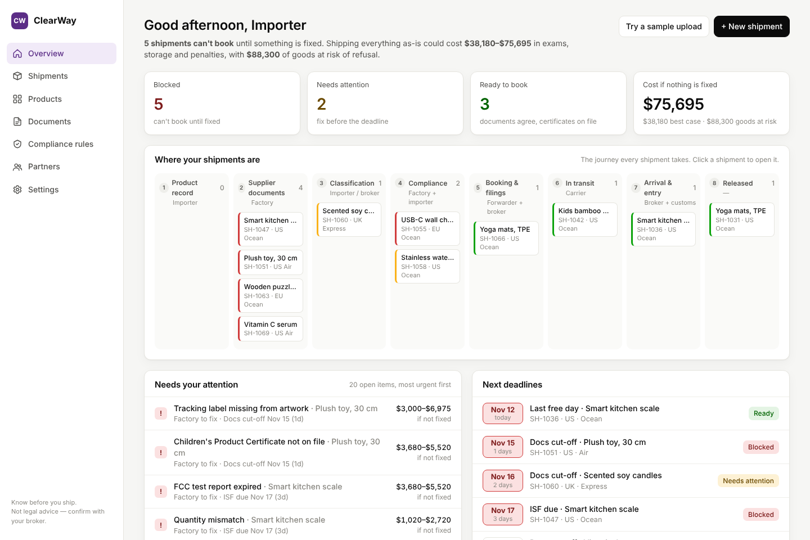

# ClearWay

**Know before you ship.** ClearWay is a shipment-readiness dashboard for small and mid-size importers and their suppliers. Upload the commercial invoice, packing list and bill of lading for a shipment and ClearWay:

1. **Extracts** the key fields from each document (with Claude, reading the real PDF/image/CSV),
2. **Cross-checks** them against each other — quantity, weight, description, consignee, HS code, Incoterm, value — and highlights every mismatch (the #1 cause of customs holds),
3. **Flags regulatory requirements** for the destination market from the product description (FCC, CPSC/CPC, FDA/MoCRA, lithium batteries, GPSR Responsible Person, CE/WEEE, UKCA, Lacey, origin marking, ISF…),
4. **Suggests a tariff classification** with a rationale and confidence,
5. Produces a **Readiness score** with a list of blockers and the fix for each, and plots every shipment on a risk map so the ones most likely to be held stand out.

It is built for the moment *before booking*, when problems are cheap to fix — not after the container is at the port.



## What's inside

| Page | What it does |
|---|---|
| **Overview** | What needs your attention first, with the cost of leaving it; where every shipment sits on its journey; next deadlines. |
| **Shipments** | All shipments, sorted by what needs you first — stage, readiness, open items, cost if not fixed, next deadline. |
| **Shipment detail** | The journey (8 stages, who owns each), every blocker with *why it matters* and *what it costs if not fixed*, three-way document check, classification, required certificates, landed-cost estimate. Mark items fixed, ask the supplier (English / 中文), share with the broker. |
| **Products** | One record per product: description, markets, classification, requirements on file, certificates with expiry. Every shipment inherits it. |
| **Documents** | Every document seen, and whether it agrees with the others on the same shipment. |
| **Compliance rules** | Each market's requirements in plain language, who provides them, official links, and what each costs when missing. Includes a "check a product" box. |
| **Partners** | Factories, forwarders, brokers — with a document-quality score and one-click document requests. |
| **Settings** | Company / IOR details, extraction status, and the editable cost model behind every estimate. |

### The journey

Every shipment moves through the same eight stages: **Product record → Supplier documents → Classification → Compliance → Booking & filings → In transit → Arrival & entry → Released.** A blocker pins the shipment to the stage where it must be fixed, so the overview board shows at a glance where things are stuck and who (factory, importer, forwarder, broker) is up.

### The cost model

Every blocker carries an estimate of what it costs if shipped as-is — exam fees, demurrage per day, broker handling, 10% marking duty for unmarked goods, $5,000 ISF liquidated damages, bonded storage during an agency detention, and the goods value at risk when a product can be refused. Defaults are typical 2025–26 US West Coast figures and are editable in Settings; the assumptions live in `public/rules.js` (`COSTS` and `impact()`).


## Quick start

Requires Node 18+. No dependencies to install.

```bash
git clone https://github.com/khaled-agi/clearway.git
cd clearway
cp .env.example .env        # add ANTHROPIC_API_KEY to enable real extraction
npm start                   # http://localhost:3000
```

Without an API key the app runs in **simulated mode**: the whole UI works, extraction results are generated from your product description so you can demo the flow. With `ANTHROPIC_API_KEY` set, uploads are sent to your own server, which asks Claude to read the documents and return structured fields plus a classification.

Try it with the files in `samples/` (they contain deliberate mismatches: 1,200 vs 1,150 units, 594 vs 580 kg, two different HS codes, a trailing dot on the consignee).

## How it works

```
browser (public/)                      server (server/server.js)              Anthropic API
───────────────────                    ─────────────────────────              ─────────────
New shipment wizard
  ├─ describe goods, destination, mode
  ├─ drop invoice / packing list / BL ──▶ POST /api/analyze ──────────────────▶ Claude reads the
  │                                        (base64 docs + context)               documents, returns
  │◀──────────────────────────────────── { ex:{inv,pl,bl}, classification } ◀── JSON fields
  ├─ three-way comparison (rules.js)   ── mismatches, missing fields
  ├─ regulatory checklist (rules.js)   ── derived from description + market
  └─ readiness score ──▶ dashboard table + risk map + shipment drawer
```

- `public/index.html`, `styles.css`, `app.js` — all pages, the new-shipment wizard, and the shipment detail. Vanilla JS, hash-routed, no build step; data persists in the browser (localStorage).
- `public/rules.js` — the rules engine: requirements catalog per market, classification keywords, journey stages, cost model. Shared by browser and server.
- `server/server.js` — static file server + `/api/analyze`. Zero dependencies.
- `samples/` — example documents with known discrepancies.

### API

`POST /api/analyze`

```json
{ "desc": "Bluetooth kitchen scale, 1200 units", "dest": "US", "mode": "Ocean",
  "docs": { "inv": [{ "name": "ci.pdf", "type": "application/pdf", "data": "<base64>" }],
            "pl":  [ … ], "bl": [ … ], "certs": [ … ], "art": [ … ] } }
```

Returns `{ simulated: false, ex: { inv, pl, bl }, classification: { code, text, why, duty, conf }, certificates: [], notes: [] }`, or `{ simulated: true }` when no key is configured. Supported inputs: PDF, PNG/JPG/WebP, CSV/TXT. (XLSX/DOCX: export to PDF or CSV first — on the roadmap.)

`GET /api/health` → `{ ok, live, model }`

## What is real and what is a prototype

| Piece | Status |
|---|---|
| Document extraction | Real when an API key is set (Claude reads the files). Simulated otherwise. |
| Three-way cross-check | Real logic, runs on whatever was extracted. |
| Regulatory checklist | Keyword rules in `rules.js` — a starting point, **not legal advice**. Needs a maintained rules table per market. |
| HS classification | Claude's suggestion when live; keyword lookup otherwise. Production should call the HTS/TARIC schedule + CBP CROSS / BTI rulings and keep a broker in the loop. |
| Readiness score, risk map, KPIs | Real, computed from blockers. The dollar exposure is a rough heuristic. |
| Seed shipments, products, partners | Demo data in `app.js`; "Restore demo data" in Settings. |
| Cost estimates | Heuristic ranges from the editable cost model — for prioritisation, not quotes. |
| Persistence, auth, supplier portal, broker sharing | Not yet — see roadmap. |

## Roadmap

- [ ] Server-side persistence (SQLite) and accounts, so suppliers and brokers get real links instead of copy-paste
- [ ] Supplier intake link (zh-CN) — factory fills in facts once; invoice/packing list/label spec generated from the record
- [ ] Live tariff data: USITC HTS API, EU TARIC, UK Trade Tariff; CBP CROSS ruling links; per-SKU change alerts
- [ ] Certificate verification (lab accreditation, report number lookup)
- [ ] Broker/forwarder read-only share links and fix requests
- [ ] XLSX/DOCX input, multi-page scans
- [ ] EU-specific checks: ICS2 ENS, IOSS, packaging EPR registration

## Disclaimer

ClearWay helps you prepare; it does not replace a licensed customs broker. Rules change often. Verify classification and regulatory requirements with your broker before filing.

## License

MIT
